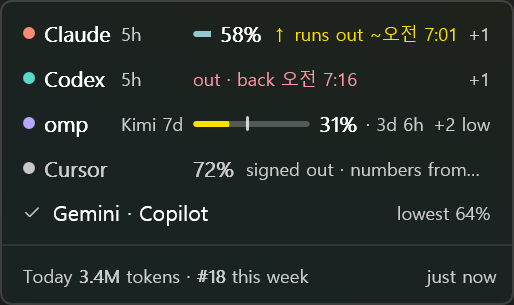
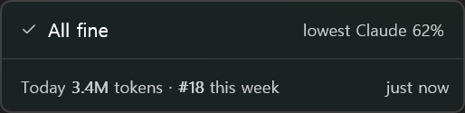
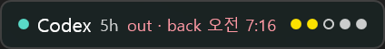
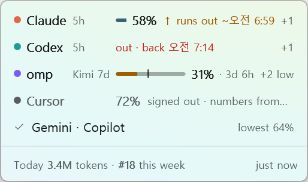
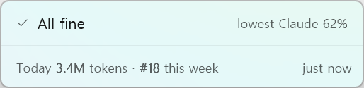
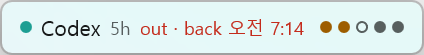

# ClaudeBar for Windows (Preview)

A Windows client for the [ClaudeBar](https://github.com/tddworks/ClaudeBar) Leaderboard.

> **Status: community-maintained preview.** Maintained by [@LunarECL](https://github.com/LunarECL). The Leaderboard client works: join, or add this PC to a membership you already have on a Mac, read the boards, share providers, show or hide yourself, upload every hour, leave. The HUD shows each AI tool's limits in a corner of the screen.
> Report Windows issues **here**, not in the ClaudeBar repo.

## Scope

- **First: the Leaderboard.** Read the local token logs of the providers that have a `usageHistory` (Claude, Codex, Mistral, omp), sum each day, and upload to the same board the macOS app uses.
- **Then: limits,** in [the HUD](#the-hud): ClaudeBar's own quota monitor over the providers it finds on this PC.

## How it's built

The board is only fair if a day counts the same on Windows as on the Mac. So this client doesn't reimplement ClaudeBar: it depends on `ClaudeBarKit`, ClaudeBar's Swift package, which is being made to build on Windows as well as macOS, one phase at a time ([MODULAR_DESIGN §10](https://github.com/tddworks/ClaudeBar/blob/main/docs/architecture/MODULAR_DESIGN.md#10--one-package-two-platforms)).

- **From the package:** reading the logs, summing a day, signing, keeping the key, the provider definitions and `vectors.json`. This client depends on `tddworks/ClaudeBar` by URL at a tag or commit, and calls the same factories as the Mac app.
- **In this repo:** the UI, the composition root, packaging and the installer. The UI is C# WinUI 3, calling the package through a C interface over its factories, which lives here too ([#2](https://github.com/tddworks/ClaudeBar-Windows/issues/2)).

**Where it stands:** §10's phases 0 to 3 are on ClaudeBar's `main`: the Leaderboard builds and passes its tests on Windows, keeps the key in Credential Manager ([tddworks/ClaudeBar#547](https://github.com/tddworks/ClaudeBar/pull/547)) and labels the machine as a PC. `native/Package.swift` pins ClaudeBar's `v0.5.23` tag.

## Install a release

On Windows 10 (2004) or later, x64. Nothing else to install: the app carries its .NET, WinUI and Swift runtimes.

1. From [Releases](https://github.com/tddworks/ClaudeBar-Windows/releases), download `ClaudeBar-Windows-<version>-x64.zip`. To check it, compare `Get-FileHash .\ClaudeBar-Windows-<version>-x64.zip` with the `.sha256` file beside it.
2. Extract it where you keep apps, for example `%LOCALAPPDATA%\Programs`, and run `ClaudeBar\ClaudeBar.exe`.
3. The preview isn't code-signed, so SmartScreen may say *Windows protected your PC*. Choose *More info*, then *Run anyway*.

**Update.** Quit ClaudeBar from its tray icon, extract the new zip over the old folder or into a new one, and run the new `ClaudeBar.exe`. The first time it runs, it points the hourly upload at its own `claudebar-upload.exe`, so the old folder can be deleted.

**Remove.** Leave the Leaderboard in Settings first: that deletes your username and uploaded days on the server, the key and the hourly task. Then quit, and delete the folder and `%LOCALAPPDATA%\ClaudeBar`. If Task Scheduler still lists *ClaudeBar Leaderboard upload*, delete it there too: leaving doesn't say when removing it failed.

## Build and run

On Windows 10 (2004) or later, x64, with:

- Swift 6.3.3 for Windows,
- Visual Studio or its Build Tools, with the MSVC x64 tools (SwiftPM links with them; `build.ps1` finds them with `vswhere`),
- the .NET 10 SDK.

```powershell
.\build.ps1             # out\win-x64\ClaudeBar.exe, with claudebar-upload.exe and ClaudeBarNative.dll beside it
.\build.ps1 -SkipApp    # the Swift side only
cd native; swift test   # the Swift side's tests, from a shell with the MSVC environment loaded
```

`build.ps1` builds the Swift side with SwiftPM, stages it with the Swift runtime DLLs and ClaudeBar's provider definitions, then publishes the WinUI 3 app self-contained around them. Run `out\win-x64\ClaudeBar.exe`.

PRs to `main` run this build and the Swift client tests on a fresh Windows
x64 runner with Swift 6.3.3 and .NET 10. See [the CI check](CONTRIBUTING.md#checks-before-a-pr)
for its scope and the equivalent local commands.

## The HUD

A small window in a corner of the screen with each AI tool's limits, as ClaudeBar reads them on this PC ([design](docs/plans/2026-10-13-hud-design.md)). It answers one question: can I keep going, and until when.

| Card | Everything fine | Strip |
|---|---|---|
|  |  |  |
|  |  |  |

*A sample reading, from `ClaudeBar.exe --hud-check`.*

- **What it shows.** For each tool, the limit that stops you first, by ClaudeBar's rule: the worst status, then running hot, then the least left, then the soonest reset. A tool that needs you gets a row: its bar, what's left, and when it resets, runs out or is back; `+12` counts its other limits, `+2 low` the ones that aren't fine. Every fine tool shares one quiet row (`✓ Codex · Gemini   lowest 62%`), and when every tool is fine that row is the whole HUD. A tool that's signed out, or couldn't be read, is dimmed and says why; numbers it had before say since when. The footer has today's tokens, your place on the board and when the limits were read. A click on a row opens the window's *Limits* page, which lists every limit. The *Strip* style is the same in one line.
- **Where.** It shows after the first reading, in the bottom-right corner. Drag it by its top edge: it snaps to the nearest corner of the screen you drop it on, 12 effective pixels inside the work area, clear of the taskbar. While the pointer is over it, its footer holds *Refresh*, *Keep on top*, *Collapse to the strip* and *Open ClaudeBar*; right-click it for *Refresh*, *Hide the HUD*, *Settings* and *Quit ClaudeBar*.
- **Notifications.** Once per limit when it falls under 20%, reaches 0, or comes back, with *Show the HUD* and *Quiet until reset*. Under Do not disturb, Windows keeps them in the notification centre.
- **The limits** come from ClaudeBar's package: its quota monitor over the providers it finds here, with the provider settings ClaudeBar keeps in `%USERPROFILE%\.claudebar\settings.json`, read and never written.

**Settings → HUD:** *Show the HUD*, *Style* (Card or Strip), *Corner*, *Keep it on top*, *Tools on the HUD*, and a *Shortcut to show or hide it* (none set). *Start with Windows*, under General, is offered once after the first reading and stays off until you accept; it's a Run entry for your user, which Settings → Apps → Startup lists too.

**What Windows does with it,** measured on Windows 11 ([research.md](design-concept/hud/research.md), and `scripts/check-hud.ps1` on this build):

- It never takes the focus to show itself, and it has no taskbar button. A click on it does activate it, because WinUI sets the focus itself, so after a click's action it hands the foreground back to the window you were in.
- It stays on top, with Mica kept active: the same tint whether it or another app is in front.
- It hides while a window covers its screen, full screen or borderless the screen's size, and comes back when that ends. A full-screen window on another screen leaves it alone. It also hides during a presentation, which isn't measured.
- A window's rectangle includes an invisible resize border (9 px left, right and below at 150%), so the HUD places the frame you see, not the rectangle.
- Self-contained builds of the Windows App SDK 2.5.1 leave out a DLL notifications need, so their buttons never reach the app ([microsoft/WindowsAppSDK#6774](https://github.com/microsoft/WindowsAppSDK/issues/6774)). The project copies it from the SDK's runtime package.
- When Windows switches between light and dark, the HUD follows, Mica and text. A custom backdrop that leaves the change to the base `SystemBackdrop` ends the app (`0xC000027B`, an `ArgumentException` from `OnDefaultSystemBackdropConfigurationChanged`), so the HUD's Mica takes it itself.

`scripts/check-hud.ps1` checks these on a PC, on a sample reading (`ClaudeBar.exe --hud-check`, which keeps its settings in `%TEMP%`). It moves the mouse, clicks, brings windows to the front and switches the Windows apps theme (putting it back after), so run it on a PC nobody is using. It prints PASS, FAIL or UNVERIFIED per check and exits 0 only when every check ran and passed.

## What it keeps, and where

| What | Where |
|---|---|
| The membership: username, shared providers, shown or hidden, last upload, days the server refused, and which PC made the key (its SMBIOS UUID hashed with the key, never the UUID) | `%LOCALAPPDATA%\ClaudeBar\settings.json`, never the key |
| The private key | Windows Credential Manager, a generic credential `com.tddworks.claudebar/leaderboard-signing-key` kept on this PC only |
| The hourly upload | A Task Scheduler task, *ClaudeBar Leaderboard upload*, that runs `claudebar-upload.exe` every hour while you're signed in. Joining adds it; leaving removes it |
| Logs | `%LOCALAPPDATA%\ClaudeBar\Logs\ClaudeBar.log`: outcomes only, never a key or a log's content |
| The app's own settings: the tray icon, the HUD (shown or not, card or strip, its corner and screen, on top, the tools taken off it, its shortcut), whether starting with Windows was offered, the tools of the last reading (drawn while the first reading after a start runs), and each limit's last status, the crossings already notified and *Quiet until reset* | `%LOCALAPPDATA%\ClaudeBar\app.json` |

**A copied key.** A cloned disk, a restored image or a copied virtual machine can bring the settings file and the key to another PC. The PC notices: its hardware UUID doesn't match the one the key was made on, so it uploads nothing and the window says why ([design §2a](https://github.com/tddworks/ClaudeBar/blob/main/docs/features/leaderboard/design.md)). *Keep the key here* is for when the other PC is gone, or this is it after a repair: this PC uploads again under the same key. If both stay in use, they overwrite each other's days. This app can't yet make the copy its own device, as the Mac can; that comes with Devices settings, which it doesn't have yet. Until then, if both PCs stay in use, keeping the key here means they overwrite each other's days.

**Adding this PC to a membership you already have.** On the Join page, *Already on the leaderboard from another computer? Add this PC* shows a code. On the Mac, in ClaudeBar's settings, *Leaderboard*, *Devices*, *Add a device*, type it, check the device it names and approve it. The PC then says which member it was approved for: if that's you, choose what this PC shares and join; if it isn't, *That's not me* removes it again and keeps nothing. This PC gets its own key, so the member's days are the Mac's plus the PC's ([design §2a](https://github.com/tddworks/ClaudeBar/blob/main/docs/features/leaderboard/design.md)). For its first week it uploads, and changes only what it shares and its own days: renaming, hiding, approving or removing devices, and leaving are for a device past its first week. The code expires after a few minutes unused.

The app and the hourly upload are separate processes over the same file. A named mutex keeps their writes to it one at a time, and each saves only what it changed since it read the file: an upload that started before you stopped sharing a provider records that it uploaded, and doesn't share the provider again. A membership that has left, or been replaced by a new join, since it read saves nothing. A save that can't reach the file, or wait 10 seconds for the lock, changes nothing and says so: the app shows it as an error, and the hourly upload exits with code 2. Leaving deletes your username and every uploaded day on the server, then the key, the file's membership and the task.

## The contract

This client speaks a contract owned by the main repo. It does not redefine it.

- **API and signing:** [`docs/features/leaderboard/design.md` §5](https://github.com/tddworks/ClaudeBar/blob/main/docs/features/leaderboard/design.md#5--the-api)
- **Signing test vectors:** [`vectors.json`](https://github.com/tddworks/ClaudeBar/blob/main/Modules/Leaderboard/Tests/vectors.json), which comes with the package
- **Provider definitions:** [`Modules/Providers/Resources/Providers`](https://github.com/tddworks/ClaudeBar/tree/main/Modules/Providers/Resources/Providers), which come with the package

Changes to the contract or to the shared code, Windows adapters included, start as an issue or PR in [tddworks/ClaudeBar](https://github.com/tddworks/ClaudeBar).

## License

[Apache-2.0](LICENSE)
